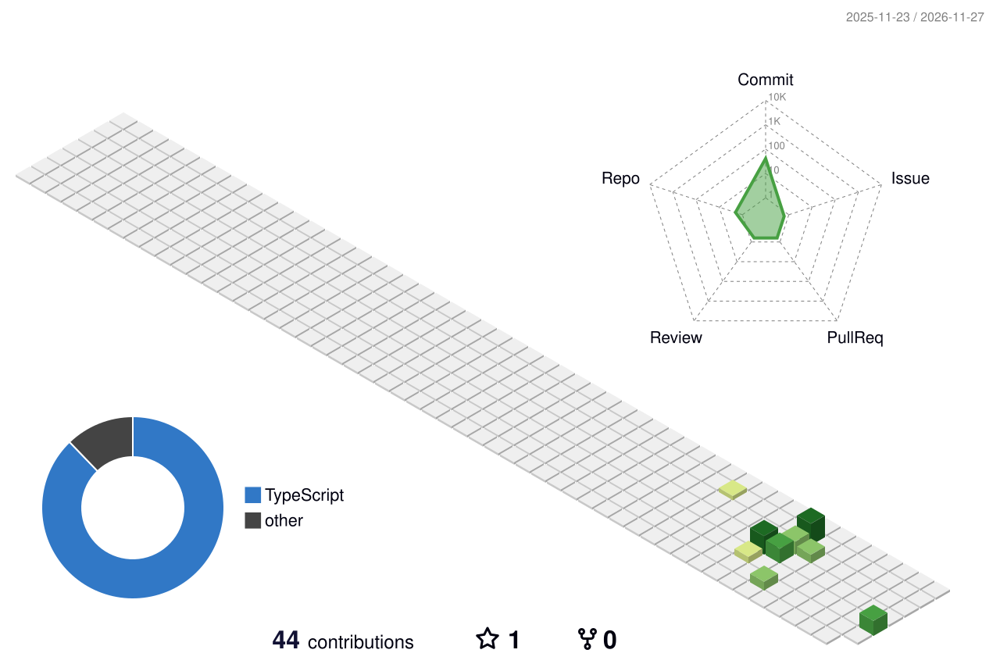

<!-- PATHAN KHAN · GitHub Profile · paqilkhansab-tech -->


<table align="center" border="0" cellpadding="10" cellspacing="0">
  <tr>
    <td align="center" width="260">
      
    </td>
    <td align="left" valign="middle">
      
      <br/>
      
      
    </td>
  </tr>
</table>

---

### Who am I

```yaml
name:      PATHAN KHAN
role:      Full-Stack Developer & AI Builder
building:  KHAN.Ai - AI-powered crypto & stock market analysis
stack:     [Next.js, TypeScript, Node.js, Prisma, PostgreSQL]
ai_brain:  Google Gemini, multi-model failover chain
infra:     Vercel - Neon Postgres - GitHub Actions
motto:     Ship fast. Fix live. Repeat.
```

- Currently building **[KHAN.Ai](https://khanai-six.vercel.app)** - an AI-powered crypto & stock market analysis platform with AI chat, voice replies, watchlists and an admin analytics dashboard
- Deep into **AI integration**: multi-model fallback chains, quota-aware retry logic and making free-tier AI APIs survive production traffic
- Everything ships on **Next.js + Vercel**, backed by **Prisma + PostgreSQL**

---

### Featured Project

[](https://github.com/paqilkhansab-tech/KHAN.Ai)

**KHAN.Ai** - live at **[khanai-six.vercel.app](https://khanai-six.vercel.app)**: AI market chat with automatic model failover, voice output, watchlists, auth and a hidden admin panel.

---

### Tech Stack

<div align="center">


</div>

---

### GitHub Stats

<div align="center">


<br/>


</div>

---

### 3D Contribution Graph

<div align="center">



</div>

---

### Contribution Snake

<div align="center">

<picture>
  <source media="(prefers-color-scheme: dark)" srcset="https://raw.githubusercontent.com/paqilkhansab-tech/paqilkhansab-tech/output/github-snake-dark.svg" />
  <source media="(prefers-color-scheme: light)" srcset="https://raw.githubusercontent.com/paqilkhansab-tech/paqilkhansab-tech/output/github-snake.svg" />
  
</picture>

</div>

---

### Trophies

<div align="center">


</div>

---


